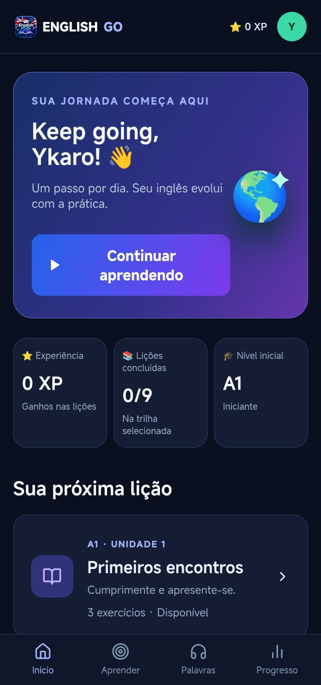
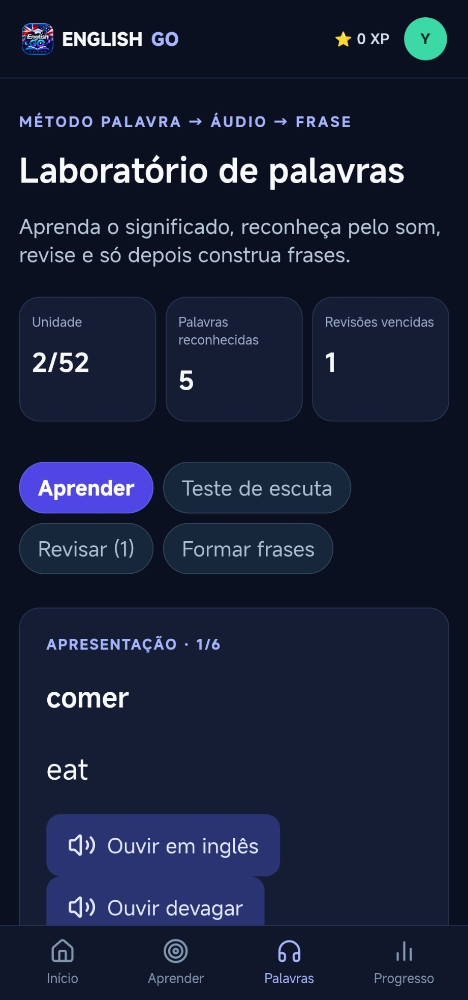
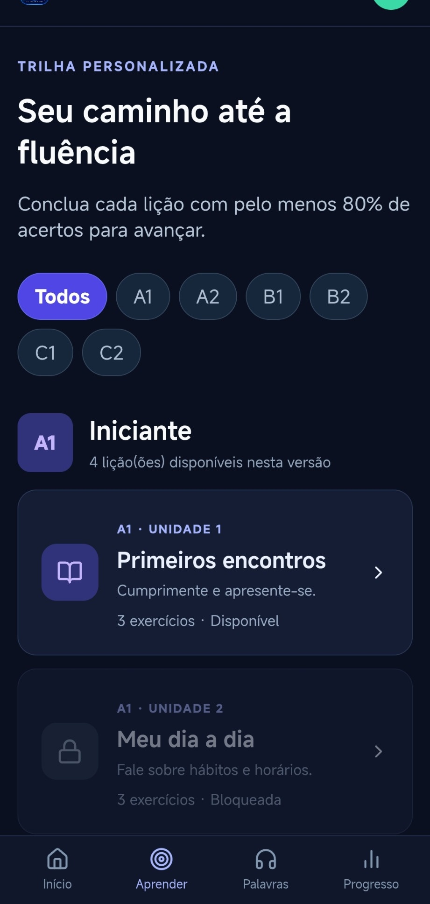

# 🇺🇸🇬🇧 English GO

**Aplicativo Android para aprender inglês com prática progressiva, exercícios e pronúncia offline.**

Projeto de portfólio desenvolvido com **React, TypeScript, Capacitor e Java**, explorando a integração de uma interface web com recursos nativos do Android.

## 📱 Telas do aplicativo

| Início | Laboratório de palavras | Trilha de aprendizagem |
|:--:|:--:|:--:|
|  |  |  |

*Capturas reais do aplicativo Android, com os indicadores do sistema removidos para apresentação.*

## ✨ Funcionalidades

- Aprendizado progressivo: **palavra → áudio → frase**.
- Exercícios de vocabulário, escuta e formação de frases.
- Revisão de palavras e acompanhamento do progresso local.
- Trilhas de aprendizado organizadas por níveis de inglês.
- Pronúncia em velocidade normal e lenta usando **Text-to-Speech nativo no Android**.
- Reprodução offline quando o dispositivo dispõe de voz inglesa instalada.
- Interface adaptada à área segura da barra de status do Android.

> **Estado do projeto:** protótipo funcional em desenvolvimento. A presença de níveis A1–C2 na interface não significa que todo o currículo esteja concluído ou que o aplicativo ofereça certificação de proficiência.

## 🛠️ Tecnologias

| Tecnologia | Utilização |
|---|---|
| React + TypeScript | Interface e lógica de aprendizagem |
| Vite | Ambiente de desenvolvimento e build |
| Capacitor | Empacotamento e integração com Android |
| Java / Android TextToSpeech | Reprodução nativa de voz |
| Android Studio / Gradle | Compilação e testes do APK |

## ▶️ Executar o projeto

Requisitos: Node.js compatível com a versão do Vite usada no projeto, Android Studio e SDK Android para compilar o aplicativo.

```bash
npm install
npm run dev
```

Para atualizar o projeto Android:

```bash
npm run build
npx cap sync android
npx cap open android
```

No Android Studio, compile o aplicativo e instale o APK em um dispositivo de teste. Para o áudio offline, configure uma voz em inglês no mecanismo de síntese de voz do Android.

## 🧩 Estrutura principal

- `src/main.tsx` — interface, navegação e atividades.
- `src/VocabularyLab.tsx` — laboratório de palavras.
- `src/audio/speak.ts` — integração da reprodução de áudio.
- `src/data/` — conteúdo e avaliações.
- `src/engine/` — progresso e revisão.
- `src/styles/app.css` — estilos e adaptação para dispositivos móveis.
- `android/` — projeto Android e integração nativa.

## 🎯 Aprendizados do projeto

A integração do áudio foi um desafio técnico importante: a API de síntese de voz do navegador não funcionou no WebView Android, exigindo integração com o `TextToSpeech` nativo e ajustes no processo de compilação Java. Também foi necessário corrigir a área segura do cabeçalho para não sobrepor os indicadores do sistema.

## 📌 Próximos passos

Ampliar o conteúdo pedagógico, fortalecer testes automatizados, melhorar acessibilidade e continuar validando a experiência em dispositivos Android reais.

---

**Desenvolvido como projeto pessoal de estudo e portfólio.**
